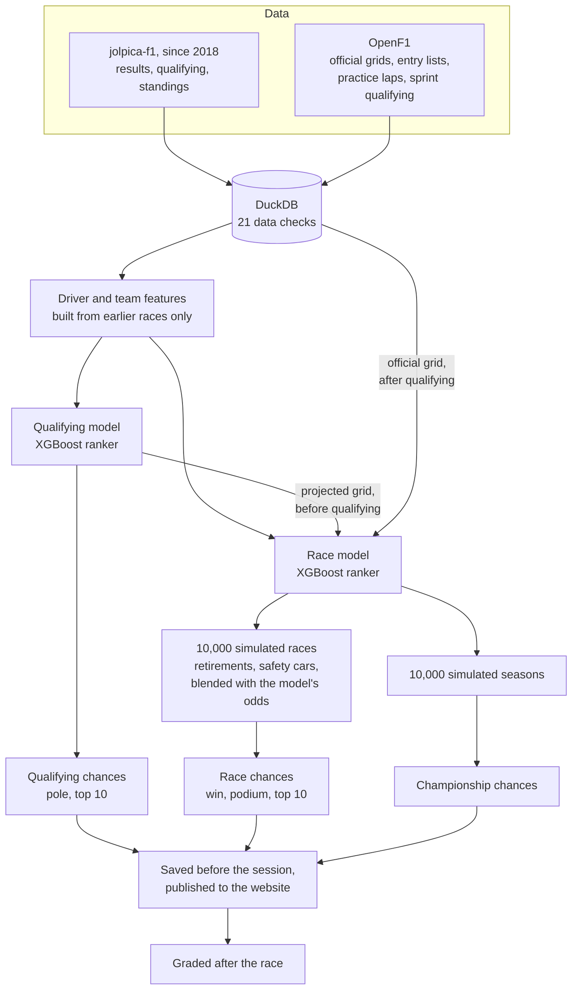

# F1 Prediction System

[](https://github.com/Parikshit06/f1pred/actions/workflows/ci.yml)

Forecasts for every Formula 1 Grand Prix. Before each session it publishes
each driver's chance to take pole, win, reach the podium and finish in the top
10, plus a championship projection. Every forecast is saved before the session
and graded against the result afterwards, so the track record is public.

**[Live forecast](https://parikshit06.github.io/f1pred/)** ·
**[Method and accuracy](https://parikshit06.github.io/f1pred/method.html)** ·
**[Past races](https://parikshit06.github.io/f1pred/races.html)** ·
**[Full methodology](METHODOLOGY.md)**

## What it predicts

Each race weekend gets three forecasts, each with more information than the
last:

| When | What it knows | What is published |
|---|---|---|
| Wednesday of race week | past races only | qualifying, race and championship forecasts |
| After practice | this weekend's practice, and sprint qualifying on sprint weekends | updated qualifying and race forecasts |
| After qualifying | the official starting grid | race forecast on the real grid |
| After the race | the result | the forecast graded on a page of its own |

Forecasts are committed to [`predictions/`](predictions/) as they are made and
never edited. The live record starts at the 2026 Azerbaijan Grand Prix.

## How it works



1. **Collect.** Results and qualifying for every race since 2018, plus
   official grids, practice times and sprint qualifying from OpenF1. 21 data
   checks run before anything is modelled.
2. **Describe each driver from the past only.** Recent results, the team's
   form, one-lap pace and record at this circuit, all built from earlier races
   so the model never sees the answer.
3. **Rank the drivers.** One model predicts the qualifying order, another the
   race order. Before qualifying, the predicted qualifying order stands in for
   the grid.
4. **Turn the order into chances.** The race is simulated 10,000 times with
   retirements, safety cars and an uncertain grid, and blended with the
   model's own odds. Win, podium and top 10 all come from one set of finishing
   chances, so they always agree.
5. **Publish, then grade.** The forecast goes out before the session and is
   scored against the result.

## How good is it

Every race from 2024 to the 2026 Singapore Grand Prix, **65 races**, was
replayed with a model that only knew the races before it. Each stage is
compared with a simple forecast anyone could make without a model:

| Forecast | Compared with | Result |
|---|---|---|
| Race, before practice | the championship order | **Better** on win chances, and names more of the top five |
| Race, after practice | the championship order | **Better** on win and podium chances, and names more of the top five |
| Qualifying | each driver's recent qualifying | **Better**, helped by practice and sprint qualifying |
| Race, after qualifying | the starting grid | **Level**. Once the grid is known it holds most of what can be predicted |

Its most confident calls are a little too sure: podium calls averaging 94%
came true 79% of the time. The full figures, with confidence intervals, are in
[METHODOLOGY.md](METHODOLOGY.md#11-results-in-detail) and on the
[method page](https://parikshit06.github.io/f1pred/method.html).

## Run it

The demo runs the whole pipeline offline on a made-up championship, with no
API keys:

```bash
git clone https://github.com/Parikshit06/f1pred.git && cd f1pred
make setup   # exact versions from uv.lock (Python 3.11-3.13)
make demo    # data, features, evaluation, forecast and website
make test    # unit, leakage and end-to-end tests
```

With real data:

```bash
make data                    # results since 2018, grids, practice (slow the first time, then cached)
make repair validate features
make predict dashboard       # forecast the next race, build the site in reports/
```

GitHub Actions runs the same steps across each race weekend and deploys the
site ([`predict.yml`](.github/workflows/predict.yml)).

## Limitations

- Not modelled: weather, tyre and pit strategy, in-race penalties, team
  orders, upgrades and safety-car timing.
- The most confident podium and top-10 calls are too sure: podium calls
  averaging 94% came true 79% of the time, and top-10 calls averaging 96% came
  true 87%.
- Grid penalties are known before the official grid only when a team announces
  them. Those are entered by hand in
  [`grid_penalties.json`](grid_penalties.json), with their source.
- 65 test races is a small sample.
- GitHub can run scheduled jobs hours late when it is busy, so a forecast can
  be logged later than planned, though still before the session.

More in [METHODOLOGY.md](METHODOLOGY.md#10-limitations).

## Data and licence

Code: MIT. Data belongs to its sources:
[jolpica-f1](https://github.com/jolpica/jolpica-f1) (CC BY-NC-SA 4.0, see its
[terms](https://github.com/jolpica/jolpica-f1/blob/main/TERMS.md)) and
[OpenF1](https://openf1.org). Practice history before October 2026 was fetched
with [FastF1](https://github.com/theOehrly/Fast-F1). This is an unofficial
project, not associated with Formula 1.
